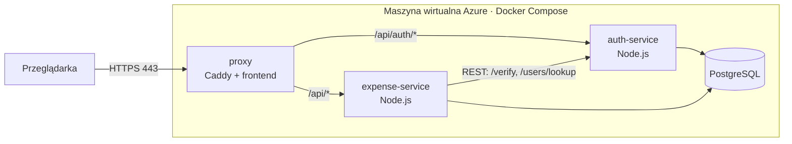

# DzielMy – rozliczanie wspólnych wydatków

Aplikacja webowa dla współlokatorów i uczestników wspólnych wyjazdów: grupy, wspólne wydatki
i automatyczne wyliczanie, kto komu ile jest winien. Projekt zaliczeniowy z przedmiotu
*Przetwarzanie w chmurach obliczeniowych*.

- **Działająca aplikacja:** https://dzielmy-lashuk.denmarkeast.cloudapp.azure.com
- **Screencast:** LINK-DO-NAGRANIA

## Spełnione kryteria oceny

| Ocena | Kryterium | Realizacja | Gdzie w repozytorium |
|---|---|---|---|
| dst | Aplikacja CRUD wdrożona w chmurze z użyciem potoku CI/CD | CRUD grup, członków i wydatków; wdrożenie na maszynę wirtualną w Microsoft Azure automatycznie po każdym pushu do `main` | `expense-service/`, `.github/workflows/ci.yml` (job `deploy`) |
| dst+ | Bezpieczeństwo przy przesyłaniu i przechowywaniu danych | HTTPS z certyfikatem Let's Encrypt (Caddy), przekierowanie HTTP→HTTPS, nagłówki HSTS/CSP; hasła jako skróty bcrypt; tokeny JWT; sekrety poza repozytorium (plik `.env` 0600, GitHub Secrets); baza niedostępna z zewnątrz; zaszyfrowany dysk maszyny | `proxy/Caddyfile`, `auth-service/src/app.js`, `infra/ansible/` |
| db | Wdrożenie w postaci maszyny wirtualnej (Terraform/Ansible) lub kontenerów (Docker Compose) | **Oba:** Terraform tworzy maszynę i sieć w Azure, Ansible ją konfiguruje, aplikacja działa w Docker Compose | `infra/terraform/`, `infra/ansible/`, `docker-compose.yml` |
| db+ | Architektura mikrousług – min. dwie komunikujące się usługi | `auth-service` i `expense-service` w osobnych kontenerach; `expense-service` weryfikuje każdy token i wyszukuje użytkowników przez REST API `auth-service` | `expense-service/src/authClient.js` |
| bdb | Testy jednostkowe i e2e w ramach potoku CI/CD | 21 testów jednostkowych (Jest, Supertest) i 3 scenariusze e2e (Playwright) na całym stosie Docker Compose; wdrożenie tylko po zaliczeniu testów, potem smoke test po HTTPS | `*/test/`, `e2e/`, `.github/workflows/ci.yml` |

## Architektura



| Kontener | Rola |
|---|---|
| `proxy` | Caddy: HTTPS (automatyczny certyfikat Let's Encrypt), routing do usług, serwowanie frontendu |
| `auth-service` | Rejestracja, logowanie, haszowanie haseł (bcrypt), wydawanie i weryfikacja tokenów JWT |
| `expense-service` | CRUD grup, członków i wydatków; wyliczanie sald i listy przelewów |
| `db` | PostgreSQL 16; każda usługa ma własny schemat (`auth`, `expenses`) |

Na zewnątrz otwarte są tylko porty 80 i 443 (proxy) oraz 22 (SSH). Usługi i baza są dostępne wyłącznie w wewnętrznej sieci Dockera.

## Potok CI/CD

`.github/workflows/ci.yml` uruchamia się przy każdym pushu i pull requeście:

1. **Lint i testy jednostkowe** – ESLint i Jest dla obu usług.
2. **Testy e2e** – `docker compose up --build`, potem Playwright w przeglądarce Chromium: rejestracja dwóch osób, grupa, dodawanie / edycja / usuwanie wydatku, rozliczenie, uprawnienia.
3. **Wdrożenie** (tylko `main`, tylko gdy testy przeszły) – kopiowanie plików na maszynę przez SSH (rsync), `docker compose up -d --build`.
4. **Smoke test** – sprawdzenie `/api/health` i `/api/auth/health` po HTTPS na działającym serwerze.

## Infrastruktura

```bash
# 1. Maszyna wirtualna, sieć, zapora i publiczny adres z nazwą DNS (Terraform)
cd infra/terraform
cp terraform.tfvars.example terraform.tfvars   # uzupełnij subscription_id, dns_label i acme_email
terraform init && terraform apply

# 2. Konfiguracja maszyny: Docker, swap, katalog aplikacji, plik .env z wylosowanymi hasłami (Ansible)
cd ../ansible
ansible-playbook playbook.yml
```

Terraform zapisuje plik `infra/ansible/inventory.ini`, więc Ansible od razu wie, gdzie się połączyć.
Sekrety wdrożenia w GitHubie: `VM_HOST` (nazwa domeny), `VM_USER` (`azureuser`), `SSH_PRIVATE_KEY`.

## Uruchomienie lokalne

```bash
cp .env.example .env
docker compose up --build
# aplikacja: http://localhost
```

## Testy

```bash
cd auth-service    && npm ci && npm run lint && npm test
cd expense-service && npm ci && npm run lint && npm test

# e2e (przy uruchomionym docker compose)
cd e2e && npm ci && npx playwright install --with-deps chromium && npx playwright test
```

## API

Przez proxy: `auth-service` pod `/api/auth`, `expense-service` pod `/api`.

| Metoda | Ścieżka | Opis |
|---|---|---|
| POST | `/api/auth/register` | Rejestracja (`email`, `password` min. 8 znaków, `name`) |
| POST | `/api/auth/login` | Logowanie, zwraca token JWT ważny 1 h |
| GET | `/api/auth/verify` | Weryfikacja tokenu (używana przez `expense-service`) |
| GET | `/api/auth/users/lookup?email=` | Wyszukanie użytkownika po e-mailu (wymaga tokenu) |
| POST / GET | `/api/groups` | Utworzenie grupy / lista moich grup |
| GET / PUT / DELETE | `/api/groups/:id` | Odczyt / zmiana nazwy / usunięcie (zmiana i usunięcie: tylko właściciel) |
| POST | `/api/groups/:id/members` | Dodanie członka po e-mailu (tylko właściciel) |
| POST / GET | `/api/groups/:id/expenses` | Dodanie wydatku / lista wydatków |
| GET / PUT / DELETE | `/api/groups/:id/expenses/:expenseId` | Odczyt / edycja / usunięcie wydatku |
| GET | `/api/groups/:id/balances` | Salda i lista przelewów „kto komu ile” |
| GET | `/api/health`, `/api/auth/health` | Stan usług |

Kwoty są przechowywane w groszach (liczby całkowite), żeby uniknąć błędów zaokrągleń.

## Struktura repozytorium

```
auth-service/        usługa uwierzytelniania (Express, bcrypt, JWT) + testy
expense-service/     usługa wydatków (Express) + testy
frontend/            interfejs (HTML, CSS, JavaScript – bez kroku budowania)
proxy/Caddyfile      reverse proxy i HTTPS
e2e/                 testy end-to-end (Playwright)
infra/terraform/     maszyna wirtualna i sieć w Azure
infra/ansible/       konfiguracja maszyny
.github/workflows/   potok CI/CD
docker-compose.yml   definicja wszystkich kontenerów
```
